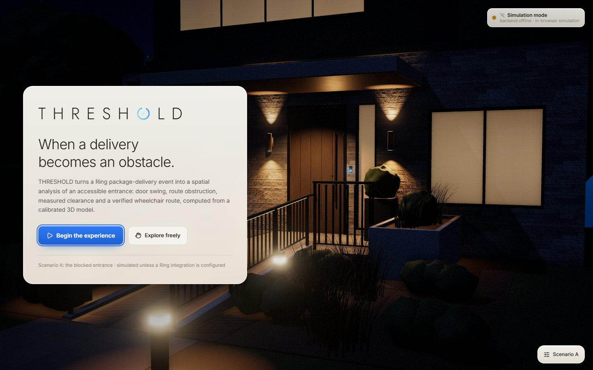
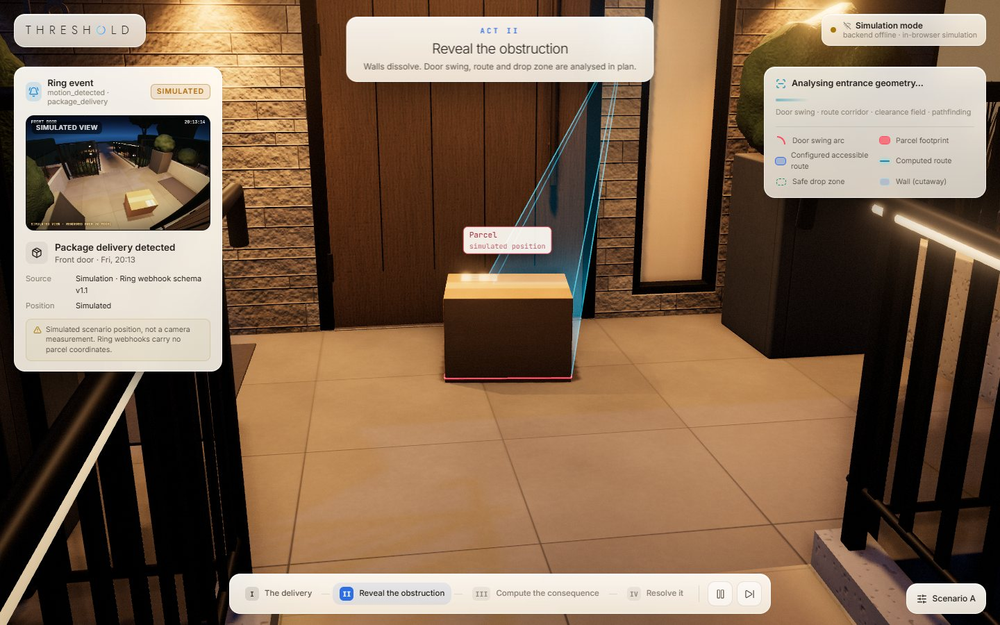
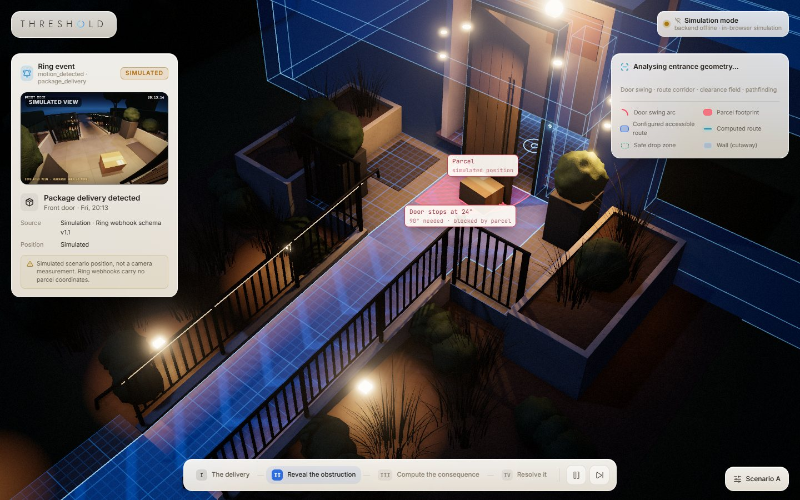
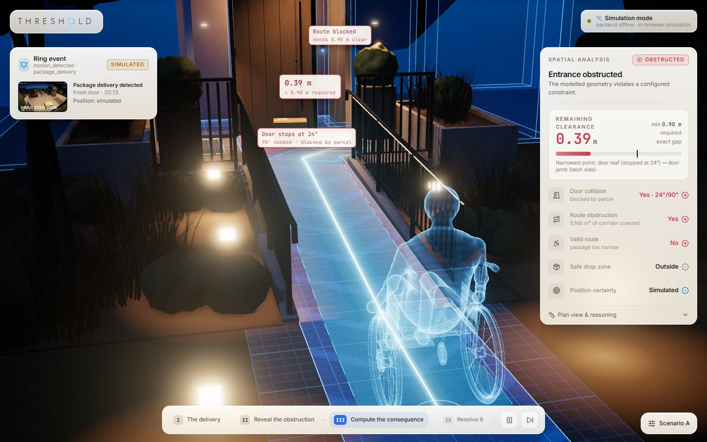
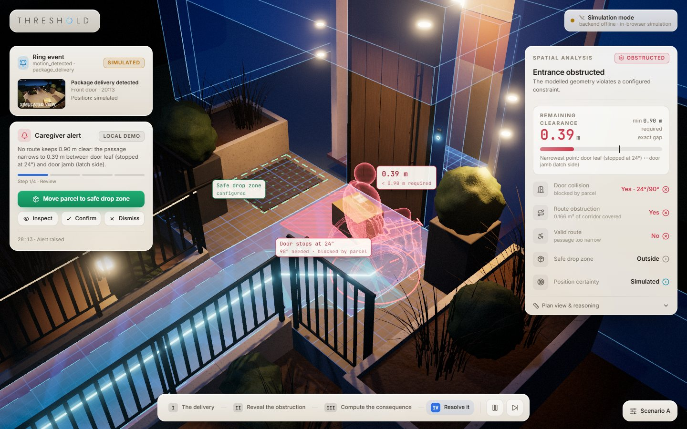
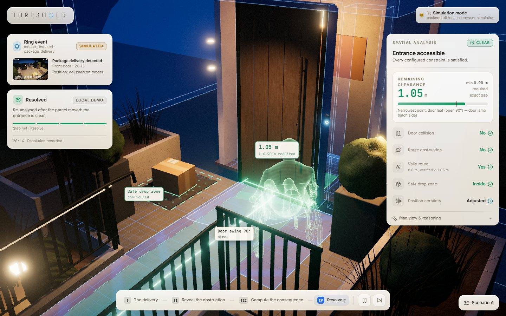
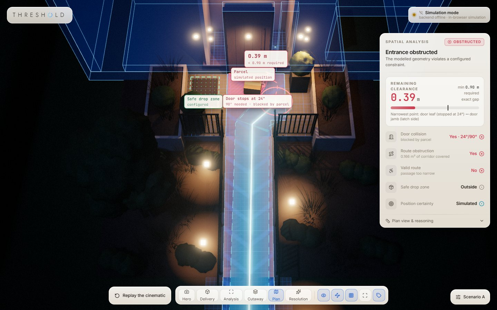

# THRESHOLD

**When a delivery becomes an obstacle.**

**Live demo: [threshold-coral-five.vercel.app](https://threshold-coral-five.vercel.app).** It is a static deploy, so Ring delivery events are simulated in the browser and labelled as simulated. Run the backend (below) to receive real Ring webhooks.

THRESHOLD turns a Ring package-delivery event into a spatial analysis of an accessible home entrance. It places the parcel in a calibrated 3D model of the entrance, then computes whether the door can still open, whether the parcel intrudes on the accessible route, how much clear width remains, and whether a wheelchair route to the door still exists. It then walks a caregiver through fixing it. Every red and green state in the scene comes from a deterministic geometry engine, not from animation.



| Act I · The delivery | Act II · Reveal the obstruction |
| --- | --- |
|  |  |
| **Act III · Compute the consequence** | **Act IV · Resolve it** |
|  |  |
| **Resolved** | **Explore mode (plan view)** |
|  |  |

## What happens in the demo (Scenario A)

1. **Delivery.** A Ring `motion_detected` event with Smart Alert `sub_type: package_delivery` arrives (simulated unless a Ring integration is configured). The parcel drops onto the landing, and the doorbell's observation cone and a simulated camera view appear. Every label says where the position came from.
2. **Reveal.** The walls dissolve into a cutaway. The door leaf physically sweeps open and stops at **24°** of the required 90°, where it touches the parcel. The parcel's overlap with the configured accessible route is hatched in red.
3. **Consequence.** A clearance-constrained A* search runs visibly. The widest possible route narrows to **0.39 m** between the stopped door leaf and the latch jamb, while **0.90 m** is configured as required. The wheelchair avatar follows the reachable part of the computed route and stops where the passage becomes too narrow.
4. **Resolve.** A local caregiver workflow (Review → Inspect → Confirm/Dismiss → Resolve) offers the fix: move the parcel to the configured safe drop zone. The parcel really moves, and the engine recomputes on every frame of the move. The door now opens 90°, the clearance becomes **1.05 m**, the route turns green, and the avatar drives in through the open door.

Scenario B (parcel already in the safe zone) runs straight to an accessible entrance. Scenario C (uncertain delivery) only has an *estimated* position, so it stops and asks a person to confirm instead of drawing a conclusion.

## Quick start

Prerequisites: Node.js 20+ (tested with 24), a WebGL 2 browser. Python 3.10+ is optional and only needed for the Ring backend. Blender is optional and only needed to rebuild the assets (tested with Blender 5.2).

```bash
npm install
npm run dev            # http://localhost:5173 (simulation mode works without any backend)
```

Optional backend (Ring webhook receiver, live status, snapshot proxy):

```bash
cd server
python -m venv .venv
.venv/Scripts/pip install -r requirements.txt -r requirements-dev.txt   # macOS/Linux: .venv/bin/pip
cd ..
npm run server         # http://127.0.0.1:8787, proxied by Vite under /api
```

Useful URL parameters: `?scenario=A|B|C`, `?autostart=1` (start the cinematic immediately), `?autoplay=0` (Act IV waits for you to move the parcel), `?speed=2` (faster playback for rehearsals).

Controls: drag the parcel in explore mode; **Q/E** or mouse wheel while dragging rotate it; **Space** pauses, **Esc** skips to explore, **R** replays, **C** toggles the cutaway. Grabbing the camera at any time hands it to you; a button returns it to the director.

Deploying: the repo deploys to Vercel as a static site (`vercel.json`). A production build makes no backend calls unless `VITE_THRESHOLD_API_BASE` is set at build time. When it is set, the site talks to that FastAPI deployment, whose `THRESHOLD_CORS_ORIGINS` must include the site's origin.

## Commands

| Command | What it does |
| --- | --- |
| `npm run dev` | Vite dev server |
| `npm run build` | Type-check and production build (`dist/`) |
| `npm test` | Geometry and integration tests (Vitest) |
| `npm run test:e2e` | Headless end-to-end smoke test against the dev server: loads the scene and drags the parcel with real mouse events (needs `npx playwright install chromium` once) |
| `npm run server` | FastAPI Ring adapter on port 8787 |
| `npm run assets` | Rebuild `public/models/*.glb` with Blender (`BLENDER=/path/to/blender` to override) |
| `npm run capture` | Headless screenshots of the tour (README images) |
| `cd server && .venv/Scripts/python -m pytest -q` | Backend tests |

## Architecture

```
src/
  geometry/            deterministic engine, no Three.js: polygons, door swing, route intrusion,
                       clearance field, widest-path + A* pathfinding, safe zone, uncertainty, validation
  config/              entrance-layout.json (calibrated entrance, meters) · scenarios A/B/C
  features/analysis/   Web Worker running the engine (latest-wins scheduling)
  features/delivery/   event → parcel placement + provenance (simulated / estimated / confirmed)
  features/notifications/  caregiver workflow (local demo, timestamped log)
  integrations/ring/   backend client: SSE stream, status, snapshot; strict event validation
  integrations/simulation/  in-browser simulated events (always labelled simulated)
  scene/               Three.js: Experience, overlays (draped on the floor), cutaway, parcel drag,
                       door, wheelchair avatar, doorbell view, camera rig, post-processing
  animation/director.ts    four-act state machine; every beat waits on the engine's real result
  components/          React UI (Tailwind)
server/                FastAPI + Pydantic Ring adapter (webhooks, signature check, SSE, snapshot)
blender/scripts/       procedural Blender build of the entrance and avatar → public/models/*.glb
tests/                 geometry/ (10 required cases + boundaries) and integration/
```

One file, `src/config/entrance-layout.json`, describes the entrance in meters. The Blender script builds the architecture from it, and the geometry engine analyses the same numbers. The frame is identical in both (+X right facing the door, +Y up, +Z toward the street; Blender stores `(x, −z, y)` and glTF converts back). The rendered model and the analysed plan therefore agree.

## Geometry engine

Full method and assumptions: [docs/geometry.md](docs/geometry.md). In short:

- **Door collision.** Two separate answers. (1) Does the parcel footprint overlap the swing region (a sector with radius equal to the leaf width)? (2) Sweep the real leaf rectangle about the hinge (separating-axis test, 0.25° steps, then bisection): what is the largest angle it reaches before touching the parcel or a planter? A parcel lower than the door undercut passes beneath the leaf.
- **Route obstruction.** Area of the parcel footprint clipped against the configured corridor (Sutherland–Hodgman). Touching the corridor edge is not an intrusion, and neither is mere proximity.
- **Clearance.** Exact point-to-segment distances on a 2.5 cm grid. A max–min (widest-path) search from the walkway to the foyer finds the route whose narrowest point is widest. The pinch is then resolved to the two features that form it, and their closed-form gap is reported (for example "door leaf (stopped at 24°) ↔ door jamb (latch side)"). If those features don't explain the grid value, the grid estimate is shown with its ±√2·h tolerance instead.
- **Route.** A* over nodes whose clearance radius is at least half the required width, which is equivalent to inflating every obstacle. Diagonal moves can't cut corners. The result is string-pulled and smoothed, then re-verified with exact distances. The avatar only ever follows this route, or its reachable prefix when the route is blocked.
- **Uncertainty.** An estimated position is evaluated at nine plausible placements. If they disagree, the verdict is *indeterminate* and a person must confirm. Confidence never replaces the geometry.
- **Required width** is a setting (0.60–1.40 m slider, 0.90 m default), not a universal standard.

Tests: `tests/geometry` covers the ten required cases: outside the route, intersecting it, door-swing hit, door-swing clear, inside the safe zone, outside it, a blocked route that becomes navigable after a move, invalid configurations, clearance below the requirement, and clearance meeting it. Boundary cases cover touching edges, a parcel just inside or just outside the leaf radius, the undercut, the analytic contact angle, and parity with Three.js `rotation.y`.

## Ring integration

THRESHOLD only uses what Ring's documentation and the official starter ([AmazonAppDev/ring-api-helloworld](https://github.com/AmazonAppDev/ring-api-helloworld)) actually provide:

- **Event:** webhook envelope v1.1, `data.type = motion_detected` with `data.attributes.sub_type = package_delivery`. That sub type requires Smart Alerts to be enabled on the device.
- **Verification:** `X-Signature: sha256=<hex HMAC-SHA256 of the raw body>` with the partner signing key, compared in constant time. Duplicates are dropped by `meta.request_id`, and the server answers within the 5 s window.
- **Snapshot:** `POST /v1/devices/{id}/media/image/download` (`at_timestamp`, JPEG, `303 → GET`), proxied by the backend for the "Request fresh snapshot" action.
- **Auth:** a Playground access token, or a refresh token plus client credentials, exactly as in the starter. Secrets live only in `server/.env` and never reach the browser.

Ring events contain **no parcel position, size or image**. The event shows *that* a delivery happened; *where* the parcel sits is estimated from the entrance's configured courier-drop prior (±0.5 m). It is shown as an estimate until a person confirms it. Simulation mode is labelled as simulation everywhere, both in the UI and in the backend model, which rejects a simulated event claiming to be live.

Setup: copy `server/.env.example` to `server/.env`, set `RING_WEBHOOK_SIGNING_KEY` (and optionally a token), run `npm run server`, then expose `/api/ring/webhook` with a tunnel such as cloudflared or ngrok. `python scripts/send_test_webhook.py` signs a documented-shape payload with your key and posts it locally, so the real verification path can be tested without Ring. Details: [server/README.md](server/README.md).

## Ring track checklist

- **The code calls Ring.**
  - [`server/threshold_server/ring/client.py`](server/threshold_server/ring/client.py) gets OAuth tokens from `oauth.ring.com` and calls `api.amazonvision.com`: `GET /v1/devices`, `GET /v1/devices/{id}/status` and `POST /v1/devices/{id}/media/image/download`.
  - The webhook entry point is `POST /api/ring/webhook` in [`server/threshold_server/main.py`](server/threshold_server/main.py). [`ring/signature.py`](server/threshold_server/ring/signature.py) verifies its signature.
  - The browser receives the normalized events through [`src/integrations/ring/client.ts`](src/integrations/ring/client.ts).
- **It works through a simulator.** You don't need a Ring device to see it run:
  - the [live demo](https://threshold-coral-five.vercel.app) runs the in-browser simulator;
  - `POST /api/simulate/delivery` emits simulated events from the server;
  - `python scripts/send_test_webhook.py` sends a signed webhook in the documented shape through the real verification path.
- **Open source.** MIT licensed; see [LICENSE](LICENSE).

## Blender asset workflow

`blender/scripts/build_entrance.py` builds the whole scene procedurally:

- **Textures:** PBR textures generated with numpy (ledgestone, smoked oak, porcelain, concrete, foliage, cardboard).
- **Entrance:** facade with openings, an out-swinging door on a hinge pivot (`Door_Pivot`), a 1:12 ramp with curbs, handrails and LED strips, the landing and walkway, planters, vegetation, fixtures, the Ring doorbell, the parcel and the safe-drop mat.
- **Organization:** objects sit in the collections `Architecture`, `Door`, `AccessibleRoute`, `Package`, `SafeDropZone`, `Railings`, `Vegetation`, `Lights` and `DecorativeProps`.
- **Export:** the GLB uses Draco geometry and WebP textures (about 2.6 MB). Walls that may be cut away carry the `threshold_role: cutaway` extra.

`blender/scripts/avatar.py` builds the wheelchair avatar: separate wheel and caster nodes, plus a figure made from metaballs. Run `npm run assets`; the `.blend` files land in `blender/source/` and are regenerated, not committed.

## Performance notes

- Shaders and draw-time GPU variants are warmed behind the loading screen. ANGLE on Windows (D3D11) otherwise compiles variants on first draw and stalls.
- The renderer keeps at most two frames in flight using GPU fences, so a slow GPU lowers the frame rate instead of building a backlog.
- Quality drops automatically (no ambient occlusion, lower resolution) if fewer than about 32 frames per second render.
- The engine runs in a Web Worker.

On an Intel Iris Xe laptop the whole tour renders at about 60 fps at 1440×900.

## Known limitations

- The parcel position for real events is estimated, not measured. No camera geometry or segmentation is attempted.
- The analysis is a plan (2D) analysis. The door is treated as a full-height slab with a configurable undercut, and slopes are only used for presentation.
- Clearance and route validity use a disc of the required width. That is a corridor-width model, not a full wheelchair footprint or turning analysis.
- The entrance model is a calibrated demo layout. A real home would need its own `entrance-layout.json`.
- The caregiver workflow is local: no SMS, push or Ring device action is sent.
- Live Ring calls (token refresh, devices, snapshot) are tested against mocked transports only. No real credentials were available during development.

## Demo script (about 2 minutes)

1. Open the app and click **Begin the experience**. Narrate the Ring event card: a *simulated* event, with the position labelled as not measured.
2. Act II: point at the door stopping at 24° and the red overlap. Pause with **Space** if needed and orbit the camera.
3. Act III: the A* search animation, then the 0.39 m vs 0.90 m pinch, and the avatar stopping.
4. Act IV: click **Move parcel to safe drop zone** and watch the numbers change during the move. The door opens, the route turns green, the avatar enters.
5. Click **Explore the model**, drag the parcel back onto the ramp, and move the required-width slider in **Scenario** to show that everything recomputes. Then switch to Scenario C to show the uncertainty handling.

## License

[MIT](LICENSE)
